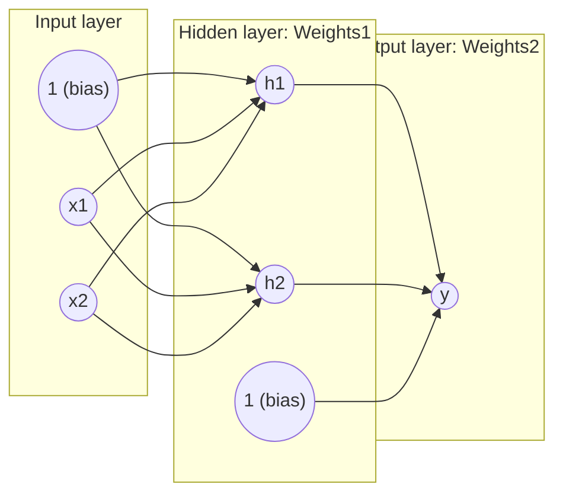
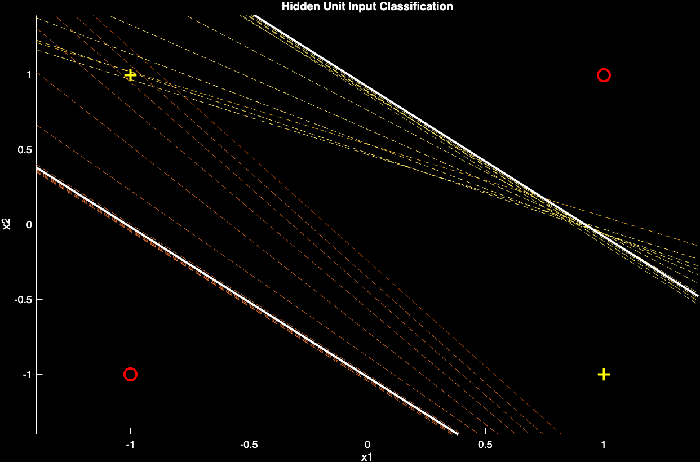
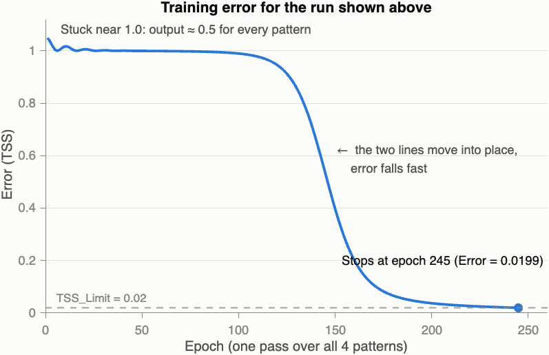
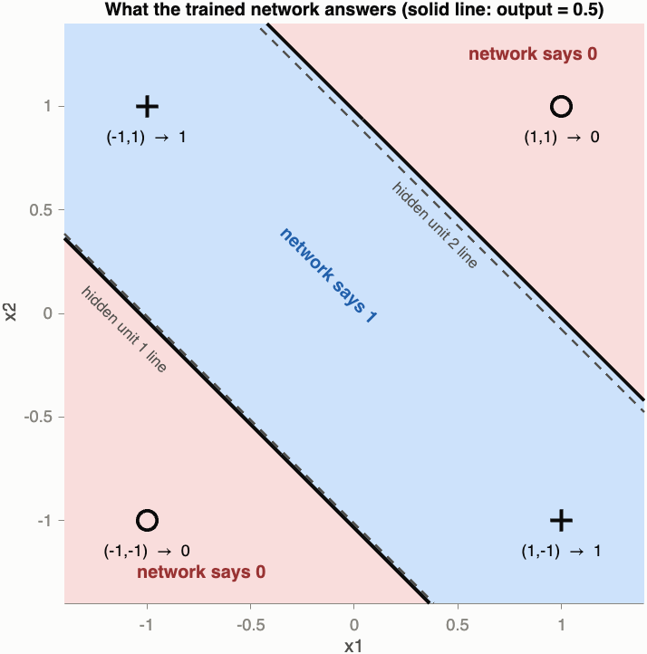
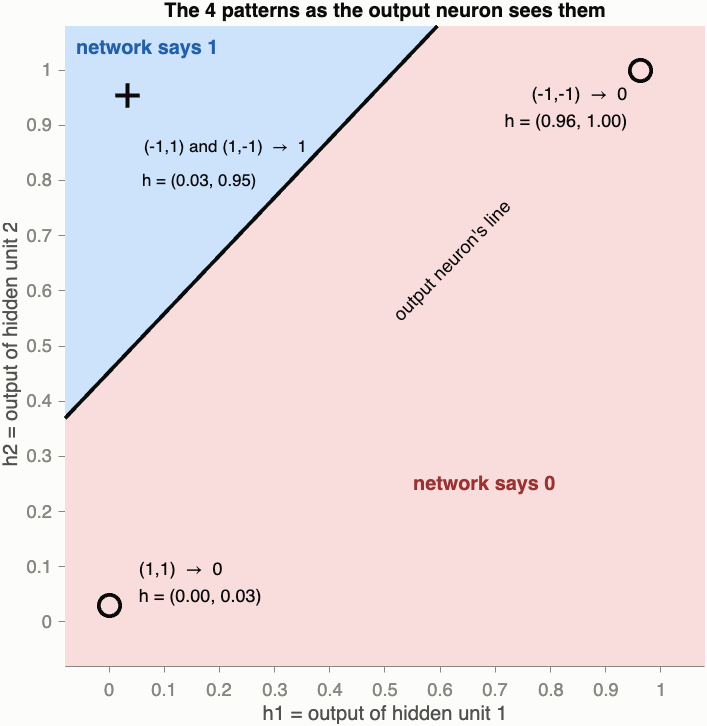

# Backpropagation on XOR (One Hidden Layer)

## 1. Main Idea
In the `XorDemo` repo we saw that **a single neuron cannot learn XOR**: the two classes sit on opposite diagonals, and no single straight line can split them.

This project fixes that by adding a **hidden layer**. It uses a small network with **2 inputs → 2 hidden neurons → 1 output**, trained with **backpropagation**.

| x1 | x2 | Target in `XorAns.dat` | Target used for training (0/1) |
|---|---|---|---|
| -1 | -1 | -1 | 0 |
| -1 | 1 | 1 | 1 |
| 1 | -1 | 1 | 1 |
| 1 | 1 | -1 | 0 |

The idea in one sentence: **each hidden neuron draws its own straight line, and the output neuron combines the two lines.** Two lines together can do what one line cannot.



- `Weights1` (2 × 3) holds the 6 arrows going into `h1` and `h2`. Row *j* is `[bias, weight from x1, weight from x2]` of hidden neuron *j*.
- `Weights2` (1 × 3) holds the 3 arrows going into `y`: `[bias, weight from h1, weight from h2]`.

**Backpropagation** is learning by repeating 4 steps:
1. **Forward:** feed the inputs through the network and get an answer.
2. **Compare:** measure how wrong the answer is (the error).
3. **Backward:** send the error back from the output to the hidden layer, so each weight knows how much it is to blame.
4. **Update:** move every weight a little in the direction that makes the error smaller.

One pass over all 4 patterns is one **epoch**. The code repeats epochs until the error is below `0.02`, or until it reaches 1000 epochs.

## 2. Equations

**Sigmoid**: the "squashing" function every neuron uses:

$$\sigma(z) = \frac{1}{1+e^{-z}}$$

It turns any number into a value between **0 and 1**. Large positive *z* gives ≈ 1, large negative *z* gives ≈ 0, and *z* = 0 gives exactly 0.5. Its slope has a very simple form:

$$\sigma'(z) = \sigma(z)\,\big(1-\sigma(z)\big)$$

That slope is why the code multiplies by `Out .* (1 - Out)` and `Hidden .* (1 - Hidden)`.

**Forward pass** for one pattern `(x1, x2)`:

$$net_j = w_{j0} + w_{j1}x_1 + w_{j2}x_2, \qquad h_j = \sigma(net_j) \qquad (j = 1, 2)$$

$$net_{out} = v_0 + v_1h_1 + v_2h_2, \qquad y = \sigma(net_{out})$$

**Error** for each pattern, and the total for all 4 patterns:

$$e = d - y, \qquad TSS = \sum_{p=1}^{4} e_p^2$$

**Backward pass** (the "blame" signals):

$$\beta = y(1-y)\,e \qquad\qquad \beta_j = h_j(1-h_j)\,v_j\,\beta$$

- `e` says **how wrong** the answer is.
- `y(1-y)` says **how much the output can still move**. It is largest (0.25) when `y = 0.5` and almost 0 when `y` is close to 0 or 1.
- A hidden neuron gets blame **in proportion to its weight** `v_j` to the output: a neuron that hardly affects the output gets hardly any blame.

**Weight update** (all 4 patterns are added together = *batch* learning), with **momentum**:

$$\Delta v = \eta \sum_{p} \beta\,[1,\ h_1,\ h_2] + \alpha\,\Delta v_{previous}$$

$$\Delta w_j = \eta \sum_{p} \beta_j\,[1,\ x_1,\ x_2] + \alpha\,\Delta w_{j,previous}$$

- `η = 0.25` is the **learning rate** (step size).
- `α = 0.9` is the **momentum**: each step keeps 90% of the previous step, like a ball rolling downhill that keeps its speed. This helps it cross flat areas of the error quickly.

These updates follow the downhill slope of the error (gradient descent), so each step makes the error a little smaller.

**Hidden-unit line** (what the plot draws): the place where `net_j = 0`, i.e. where hidden neuron *j* outputs exactly 0.5:

$$w_{j0} + w_{j1}x_1 + w_{j2}x_2 = 0 \;\Rightarrow\; x_2 = \frac{-w_{j1}x_1 - w_{j0}}{w_{j2}}$$

**Symbol ↔ code:**

| Math | Code | Meaning |
|---|---|---|
| `x` | `Inputs1` | inputs with a bias row of 1s |
| `w` | `Weights1` | input → hidden weights |
| `h` | `Hidden` | hidden neuron outputs |
| `v` | `Weights2` | hidden → output weights |
| `y` | `Out` | network answer |
| `d` | `Desired` | correct answer (target) |
| `e` | `Error` | `d - y` |
| `β` | `Beta` | output blame signal |
| `β_j` | `HiddenBeta` | hidden blame signals |
| `η` | `LearnRate` | step size |
| `α` | `Momentum` | how much of the last step to keep |

## 3. Code, Line by Line

| File | What it does |
|---|---|
| `bpnnxor.m` | Main script: loads the data, builds the network, trains it |
| `PlotBpPats.m` | Draws the 4 training points |
| `PlotBpBoundary.m` | Draws the line of each hidden neuron |
| `XorPats.dat` | The 4 input patterns, one per row |
| `XorAns.dat` | The 4 targets (-1 or +1), one per row |

### `bpnnxor.m`
```matlab
close all                                     % close old figures
% (header comments: author, source)
load XorPats.dat                              % creates variable XorPats (4 x 2), one pattern per row
load XorAns.dat                               % creates variable XorAns  (4 x 1), -1 or +1 per pattern
Patterns = XorPats';                          % transpose → 2 x 4: each COLUMN is one pattern [x1; x2]
Desired = XorAns';                            % 1 x 4: [-1 1 1 -1]
[NINPUTS,NPATS] = size(Patterns);             % NINPUTS = 2 inputs, NPATS = 4 patterns
NHIDDENS = 2;                                 % 2 hidden neurons
[NOUTPUTS,NPATS] = size(Desired);             % NOUTPUTS = 1 output neuron
PlotBpPats(Patterns,Desired);                 % draw the 4 points (this function expects -1/+1)
Desired = (Desired + 1) / 2;                  % ← My modification: -1 → 0 and +1 → 1, so targets fit sigmoid's 0..1
LearnRate = 0.25; Momentum = 0.9; DerivIncr = 0;
                                              % ← My modification: Momentum 0 → 0.9 (DerivIncr is never used)
deltaW1 = 0; deltaW2 = 0;                     % "previous step" for momentum starts at 0
Inputs1 = [ones(1,NPATS); Patterns];          % add a row of 1s for the bias → 3 x 4
Weights1 = rand(NHIDDENS,1+NINPUTS)-0.5;      % 2 x 3 random weights between -0.5 and 0.5
Weights2 = rand(NOUTPUTS,1+NHIDDENS)-0.5;     % 1 x 3 random weights between -0.5 and 0.5
TSS_Limit = 0.02                              % stop when the error is below this (no ';' so MATLAB prints it)

for epoch = 1:1000                            % at most 1000 epochs
  % Forward propagation
  NetIn1 = Weights1 * Inputs1;                % 2 x 4: net input of each hidden neuron, for all 4 patterns at once
  Hidden = 1.0 ./( 1.0 + exp( -NetIn1 ));     % sigmoid → hidden outputs h1, h2 (between 0 and 1)
  Inputs2 = [ones(1,NPATS); Hidden];          % add the bias row of 1s → 3 x 4
  NetIn2 = Weights2 * Inputs2;                % 1 x 4: net input of the output neuron
  Out = 1.0 ./ ( 1.0 + exp( -NetIn2 ));       % sigmoid → the network's 4 answers y (between 0 and 1)
  % Backward propagation of errors
  Error = Desired - Out;                      % e = d - y for each pattern
  TSS = sum(sum( Error.^2 ));                 % Total Sum of Squares: one number for "how wrong overall"
  Beta = Out .* (1.0 - Out) .* Error;         % β = y(1-y)e: output blame for each pattern
  bperr = ( Weights2' * Beta );               % send β back through Weights2 → 3 x 4 (row 1 is the bias)
  HiddenBeta = Hidden .* (1.0 - Hidden) .* bperr(2:end,:);
                                              % β_j = h_j(1-h_j)·v_j·β (bias row dropped: it has no neuron)
  % Calculate the weight updates:
  dW2 = Beta * Inputs2';                      % 1 x 3: Σ over the 4 patterns of β·[1 h1 h2]
  dW1 = HiddenBeta * Inputs1';                % 2 x 3: Σ over the 4 patterns of β_j·[1 x1 x2]
  deltaW2 = LearnRate * dW2 + Momentum * deltaW2;   % step = η·(this gradient) + α·(previous step)
  deltaW1 = LearnRate * dW1 + Momentum * deltaW1;
  % Update the weights:
  Weights2 = Weights2 + deltaW2;
  Weights1 = Weights1 + deltaW1;
  fprintf('Epoch %3d:  Error = %f\n',epoch,TSS);    % print progress
  if TSS < TSS_Limit, break, end              % good enough → stop training
  if rem(epoch-1,20)==0, PlotBpBoundary(Weights1,epoch,'--'), end
                                              % every 20 epochs (1, 21, 41, ...) draw dashed hidden-unit lines
end
PlotBpBoundary(Weights1,epoch,'-')            % draw the final hidden-unit lines (solid)
```

> **Notes:**
> - Each `Error` printed for an epoch is measured **before** that epoch's weight update.
> - `DerivIncr` is set but never used.
> - The plot only shows the **hidden-unit lines**, not the network's final answer. Section 4 shows both.

### `PlotBpPats.m`
```matlab
function PlotBpPats(P,D)                     % P = patterns (2 x 4), D = targets (1 x 4, -1/+1)
if nargin ~=2, error('Wrong number of arguments.'); end
[M,N] = size(P);                             % M = 2 coordinates, N = 4 points
Q = size(D,1);                               % Q = 1 output
D = (D+1)/2;                                 % -1/+1 → 0/1
if Q<2, D=[D;zeros(1,N)];,end                % only 1 output → add a row of zeros (code supports 2 outputs)
% clf reset, whitebg(gcf,[0 0 0])            % (commented out) would make the background black
hold on                                      % keep drawing on the same figure
xmin = min(P(1,:)); xmax = max(P(1,:)); xb = (xmax-xmin)*0.2;   % data is -1..1 → margin 0.4
ymin = min(P(2,:)); ymax = max(P(2,:)); yb = (ymax-ymin)*0.2;
axis([xmin-xb, xmax+xb,ymin-yb, ymax+yb]);   % axes from -1.4 to 1.4
title('Hidden Unit Input Classification');
xlabel('x1'); ylabel('x2');
class = 1 + D(1,:) + 2*D(2,:);               % target 0 → class 1, target 1 → class 2
colors = [1 0 0; 1 1 0; 0 1 0; 0 0 1];       % red, yellow, green, blue
symbols = 'o+*x';
for i=1:N
  c = class(i);
  plot(P(1,i),P(2,i),symbols(c),'Color',colors(c,:));   % class 1 = red o, class 2 = yellow +
end
```
So **red `o` = target 0**, and **yellow `+` = target 1**.

> This is why my modification converts the targets **after** calling `PlotBpPats`. If it receives 0/1 instead of -1/+1, `class` becomes 1.5, and MATLAB stops with `Array indices must be positive integers or logical values.`

### `PlotBpBoundary.m`
```matlab
function PlotBpBoundary(W,iter,style)        % W = Weights1 (2 x 3), iter = epoch, style = '--' or '-'
NUNITS = size(W,1);                          % 2 hidden neurons → 2 lines
colors = get(gca,'ColorOrder');              % MATLAB's default line colors
ncolors = size(colors,1);
c1 = [...]; c2 = ...; colorsteps = 5;        % color fading: only used when there is ONE unit
cb = ...; ci = ...; cj = ...; ck = ...;      % (not used here: we have 2 units)
temp = axis; xrange = temp(1:2);             % left and right edge of the plot: [-1.4 1.4]
for i = 1:NUNITS
  if size(style)==1                          % true only for '-' (1 character) = the final call
    color = [1 1 1];                         % white
  elseif NUNITS > 1                          % our case during training
    color = colors(1+rem(i,ncolors),:);      % unit 1 → orange, unit 2 → yellow
  else
    color = (1-ck)*c1(ci,:) + ck*c2(ci,:);   % single-unit case (not used here)
  end
  plot(xrange,(-W(i,2)*xrange-W(i,1))/W(i,3),'LineStyle',style,'Color',color);
                                             % the line where net_i = 0: x2 = (-w1*x1 - w0)/w2
end
drawnow                                      % show it now
```

> `size('-')` is `[1 1]`, so `size(style)==1` is all true. `size('--')` is `[1 2]`, so it is not all true. That is how the function tells the final call from the training calls.

### My Modifications (and Why)
The original code had **2 problems**:

1. **The targets could never be reached.** `XorAns.dat` asks for **-1**, but the sigmoid can only output values between **0 and 1**. For the two patterns with target -1, the error is always at least 1, so `TSS` can never go below 2, and it can never reach `0.02`. In my run of the original code, the error was still **3.15** after 1000 epochs.
   **Fix:** `Desired = (Desired + 1) / 2;` turns the targets into 0/1. `XorAns.dat` is not changed.
2. **Learning was too slow.** The sigmoid's slope is at most 0.25, so the steps are small. With 0/1 targets but no momentum, a run needs about **2900 epochs**, which is more than the 1000 allowed.
   **Fix:** `Momentum = 0.9`.

I tested each version with 100 different random starts:

| Version | Runs reaching `Error < 0.02` within 1000 epochs | Typical epochs needed |
|---|---|---|
| Original code | **0 / 100** | never |
| Targets 0/1 only | **0 / 100** | ~2900 |
| Targets 0/1 + Momentum 0.9 (**this repo**) | **94 / 100** | ~310 |

## 4. Result
### Actual run (MATLAB R2026b)
Every run starts from random weights, so every run is a little different. For the images below, `rng(1); bpnnxor` was typed in the Command Window, so this exact run can be repeated.



**What you see:**
- **Red `o` points:** `(-1,-1)` and `(1,1)`, target 0.
- **Yellow `+` points:** `(-1,1)` and `(1,-1)`, target 1.
- **Orange dashed lines** show hidden unit 1 every 20 epochs (epochs 1, 21, …, 241). It starts steep through the middle (`x2 ≈ -1.42·x1 - 0.24`) and slides down-left until it settles at `x2 ≈ -x1 - 1.02`. There it **cuts off the corner `(-1,-1)`**.
- **Yellow dashed lines** show hidden unit 2. It starts almost flat (`x2 ≈ -0.48·x1 + 0.54`) and turns until it settles at `x2 ≈ -x1 + 0.92`. There it **cuts off the corner `(1,1)`**.
- From about **epoch 121–141**, both lines have slope -1 (they are parallel), and after that they hardly move.
- **White solid lines** are the final lines at epoch 245. The two `+` points sit **between** the lines, and each `o` is alone on the outer side of one line.

**Console output (shortened):**
```
TSS_Limit =

    0.0200

Epoch   1:  Error = 1.048212
Epoch   2:  Error = 1.040043
Epoch   3:  Error = 1.026995
...
Epoch 243:  Error = 0.020350
Epoch 244:  Error = 0.020145
Epoch 245:  Error = 0.019944
```
Training stopped at **epoch 245**, when the error fell below 0.02.

Final weights: `Weights1 ≈ [-3.36 -3.31 -3.31; 3.01 -3.27 -3.27]`, `Weights2 ≈ [-2.58 -6.00 5.69]`. With these weights:

| Pattern | h1 | h2 | Output y | Target | |
|---|---|---|---|---|---|
| (-1,-1) | 0.963 | 1.000 | 0.065 | 0 | ✅ |
| (-1, 1) | 0.034 | 0.953 | 0.934 | 1 | ✅ |
| ( 1,-1) | 0.034 | 0.953 | 0.934 | 1 | ✅ |
| ( 1, 1) | 0.000 | 0.029 | 0.082 | 0 | ✅ |

**All 4 correct.** Each hidden neuron learned a simple job:
- **h1** is ON (≈1) **only for `(-1,-1)`**. It asks: "are both inputs -1?"
- **h2** is OFF (≈0) **only for `(1,1)`**. It asks: "are the inputs NOT both +1?"
- **The output** `y = σ(-2.58 - 6.00·h1 + 5.69·h2)` says 1 when **h2 is ON and h1 is OFF**. That is exactly the two middle patterns, which is **XOR**.

> Screenshot note: the figure was saved with a black background (what the original code was designed for, see the commented `whitebg` line), so the white final lines and the yellow `+` are visible. The points and the final lines were drawn thicker for the screenshot only. The three figures below were made after the run from the same weights, without changing the lab code.

### How the error went down


- **Epochs 1–~110: stuck near 1.0.** The network answers ≈ 0.5 for every pattern (at epoch 50: `[0.508 0.505 0.511 0.507]`), so each error is ≈ 0.5, and `TSS ≈ 4 × 0.5² = 1`.
- **Epochs ~110–200: fast drop.** The two lines move into place (see the dashed lines above), and the error falls from 0.98 to 0.04.
- **Epochs 200–245: slow finish.** The answers get closer to 0 and 1 until the error is below 0.02.

### What the whole network answers
The lab plot shows only the hidden-unit lines. This figure shows the **network's real answer** for every point of the plane. Blue means the output is above 0.5 ("1"), and red means it is below 0.5 ("0").



The solid line (output = 0.5) sits almost on top of the two dashed hidden-unit lines. The "1" area is the **band between the two lines**, and the two "0" corners are outside it. Here the decision boundary is two straight lines rather than a curve, because the two hidden lines ended up parallel.

### Why the hidden layer solves XOR
This figure shows the 4 patterns **as the output neuron sees them**: not as `(x1, x2)`, but as `(h1, h2)`.



- `(-1,1)` and `(1,-1)` both land on the **same point** `(0.03, 0.95)`.
- `(-1,-1)` lands at `(0.96, 1.00)`, and `(1,1)` lands at `(0.00, 0.03)`.
- Now **one straight line** (the output neuron's line `-2.58 - 6.00·h1 + 5.69·h2 = 0`) separates the "1" from the two "0"s.

So the hidden layer **moves the points** into a new space where the problem becomes easy. A problem that **one line cannot solve** (see `XorDemo`) becomes one that **one line can solve**.

### Summary
- The network learns XOR in **245 epochs**, with final error **0.0199**.
- Hidden unit 1 cuts off `(-1,-1)`, hidden unit 2 cuts off `(1,1)`, and the output answers 1 only **between** the two lines.
- The error first sits at ≈ 1.0, then drops quickly once the hidden lines move into place.
- The original code could never succeed, because the sigmoid can't output -1. Converting the targets to 0/1 and adding momentum fixed it.

> **Run it more than once:** about **6 in 100** runs get stuck. The error stops at about **0.50** (two answers stuck near 0.5) or **0.67** (three answers near 0.67) and stays there until epoch 1000. This is a known trap for XOR with only 2 hidden neurons, not a bug. Just run `bpnnxor` again to get new random weights.

## 5. Example: One Training Step by Hand
Let's follow **one pattern**, `(-1, 1)` with target `d = 1`, through the network, using the real starting weights of the run above:

```
Weights1 = [-0.083  -0.500  -0.353      ← hidden 1: [bias, from x1, from x2]
             0.220  -0.198  -0.408]     ← hidden 2
Weights2 = [-0.314  -0.154  -0.103]     ← output:   [bias, from h1, from h2]
```

**Step 1: Forward (hidden layer)**
```
net1 = -0.083 + (-0.500)(-1) + (-0.353)(1) = 0.064   →  h1 = σ(0.064) = 0.516
net2 =  0.220 + (-0.198)(-1) + (-0.408)(1) = 0.010   →  h2 = σ(0.010) = 0.503
```

**Step 2: Forward (output)**
```
netOut = -0.314 + (-0.154)(0.516) + (-0.103)(0.503) = -0.445   →  y = σ(-0.445) = 0.390
```
The network says **0.390**, but the answer should be **1**.

**Step 3: Error**
```
e = d - y = 1 - 0.390 = 0.610
```

**Step 4: Output blame**
```
β = y(1-y)e = 0.390 × 0.610 × 0.610 = 0.145
```

**Step 5: Send the blame back to the hidden neurons**
```
β1 = h1(1-h1) × v1 × β = 0.516 × 0.484 × (-0.154 × 0.145) = -0.0056
β2 = h2(1-h2) × v2 × β = 0.503 × 0.497 × (-0.103 × 0.145) = -0.0037
```
The hidden blame is small because the hidden → output weights (`-0.154`, `-0.103`) are still small.

**Step 6: Weight changes from this one pattern**
```
Output:   η × β × [1, h1, h2]   = 0.25 × 0.145 × [1, 0.516, 0.503] = [0.036, 0.019, 0.018]
Hidden 1: η × β1 × [1, x1, x2]  = 0.25 × (-0.0056) × [1, -1, 1]    = [-0.0014, 0.0014, -0.0014]
Hidden 2: η × β2 × [1, x1, x2]  = 0.25 × (-0.0037) × [1, -1, 1]    = [-0.0009, 0.0009, -0.0009]
```
All the output weights go **up**, which pushes `y` up toward the target 1. ✅

**Step 7: What the code really does**
The code does Steps 1–6 for **all 4 patterns at once** (using matrices) and **adds up** the 4 weight changes. Then it adds **0.9 × the previous step** (momentum) and updates the weights. That is one epoch. In the run above, this was repeated **245 times**.
